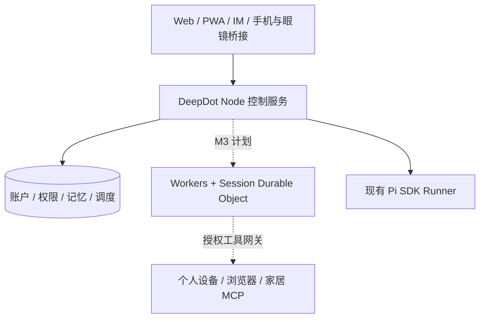

<p align="center"></p>
<h1 align="center">DeepDot</h1>
<p align="center"><strong>一个持续接受委托、记住你，并连接随身设备与家庭的个人 AI 助手。</strong></p>
<p align="center"><a href="https://github.com/Cordis798/DeepDot/actions">CI</a> · <a href="#快速开始">快速开始</a> · <a href="docs/deepdot/ROADMAP.md">路线图</a> · <a href="docs/deepdot/FEATURE-GAPS.md">功能状态</a></p>

DeepDot 是面向个人的自托管 Personal Agent 项目，对标 Grok Dot 的随身交互方向。采用单 Agent 产品路线，逐步扩展云端持久执行、第一视角感知、长期记忆和智能家居控制。

**当前阶段：M2 单 Agent 收敛。** 可运行基础包含 Web/PWA、Pi SDK 会话、工作区权限、定时任务、结构化记忆、Skills/MCP 与用量账本。云端 Durable、眼镜和家居控制属于后续阶段，不代表当前已交付。

## 三个使用场景

- **持续委托**：将资料研究或远程任务交给助手，查看进度、处理确认、接收交付；长期 Goal 与检查点恢复在 M3–M5 实施。
- **随身助手**：通过手机桥接或具有开放接口的眼镜输入第一视角图像和语音，识别物品、读取纸面文字、查询物品位置，再调用云端助手完成任务；M11 实施。
- **家庭与电脑**：由同一个助手调用授权的电脑、浏览器和家居 MCP，执行后回读结果；M7–M10 实施。

## 能力与进度

| 能力                                           | 当前状态                                   | 交付阶段 |
| ---------------------------------------------- | ------------------------------------------ | -------- |
| Web/PWA、流式聊天、工作区与权限                | 已有自动化验收基础；真实移动端另验         | M12 扩展 |
| Pi Agent SDK、Host/Container 适配              | SDK/协议已验；实际模型与 Docker 另验       | 保留     |
| Skills、受治理 MCP、Plugin 目录                | 已有基础；任意扩展执行不开放               | 保留     |
| cron/interval/once、通知账本                   | 已有自动化验收基础                         | M5 扩展  |
| 结构化记忆、来源与修订历史                     | 已有基础，当前为 LIKE 搜索                 | M6 扩展  |
| Durable 模型/工具检查点与崩溃恢复              | 计划中                                     | M3–M4    |
| Workers + SQLite Durable Objects、Alarm 唤醒   | 计划中，Node 保管凭据和授权                | M3       |
| Request ID、摘要去重、工具分级与 uncertain     | 已有输入账本；完整副作用恢复计划中         | M4       |
| Goal、完成条件、遇阻提问与持续委托             | 计划中                                     | M5       |
| 偏好记忆、Mem0 语义召回与上下文选择            | 计划中                                     | M6       |
| 设备配对、有限授权、MCP Call Intent            | 计划中                                     | M7       |
| Computer Use、应用/窗口绑定与输入串行          | 计划中                                     | M8       |
| 分级审批、密码打码、截图脱敏加密               | 计划中                                     | M8       |
| 受控读页、隔离浏览器与网页指令注入隔离         | 计划中                                     | M9       |
| 单一智能家居 MCP、可插拔 Provider 管理         | 计划中                                     | M10      |
| 第一视角物品/文字识别、位置记忆、ASR/TTS       | 计划中；先手机桥接，眼镜真机另验           | M11      |
| 飞书、钉钉、Telegram、Discord、WhatsApp        | 适配器/Fake Transport 已测，真实连接待完成 | M12      |
| Electron 轻量桌面端                            | 计划中                                     | M12      |
| OpenTelemetry/Langfuse、逐步耗时用量与失败定位 | 结构化日志已有，完整链路计划中             | M13      |

每项只在此出现一次；详细边界和代码证据见[功能差距清单](docs/deepdot/FEATURE-GAPS.md)。历史协作执行入口已在 M2 退役，仅保留受权限保护的历史查询。

## 架构



实线为现有基础，虚线为规划。Workers 不直接运行桌面、Docker 或任意 stdio MCP；设备经配对授权后连接云端。运行目标是同一个 Personal Agent，而非眼镜本地轻量模型。

## 家居 Provider

| Provider       | 接入路径                                                                              | 状态     |
| -------------- | ------------------------------------------------------------------------------------- | -------- |
| Home Assistant | REST/WebSocket，发现、查询、动作与状态回读                                            | M10 计划 |
| 米家           | 独立配置，经[小米官方 HA 集成](https://github.com/XiaoMi/ha_xiaomi_home)桥接，需要 HA | M10 计划 |
| 涂鸦           | 官方云 API，按账号、区域和设备能力配置                                                | M10 计划 |
| 机器人         | 复用 Provider 契约，型号另定                                                          | 扩展位置 |

统一实体、能力与错误回报；同一设备在 HA/品牌入口中显式关联，避免重复控制。任务规划由 Personal Agent 承担，Provider 仅实现品牌适配。

## 快速开始

Node.js 24、npm；首次安装使用预编译依赖，详见[M0 基线](docs/deepdot/M0-BASELINE.md)。

```powershell
git clone https://github.com/Cordis798/DeepDot.git
cd DeepDot
npm ci --ignore-scripts
npm run build
$env:DEEP_WORKER_RUNNER = "fake"
npm run dev -w server
# 另开终端
npm run dev -w web -- --host 127.0.0.1
```

打开终端打印的地址完成管理员初始化。Fake Runner 可用于无模型密钥的演示；接入真实模型需配置本地 Provider 凭据。密钥不写入仓库。

## 品牌与兼容

仓库与应用为 DeepDot，包为 `deepdot` / `@deepdot/*`。保留 `DEEP_WORKER_*`、`dw_session`、旧 localStorage 键、数据目录和 `deep-worker.db`，现有部署不因改名丢失数据。旧仓库地址由 GitHub 重定向。

图标源为用户选定的 `assets/deepdot-logo.png`，`assets/deepdot.svg` 为自动生成的等比 SVG 容器，运行 `npm run generate:icons` 生成 Web/PWA PNG 和 README Logo，构建自动重新生成。新增 `@resvg/resvg-js` 仅用于可重复 SVG 渲染，不参与业务运行。当前没有 Electron 安装包，后续复用同一图标源。

## 开发与贡献

```bash
npm run build
npm run typecheck
npm test -- --run
git diff --check
```

遵守 [AGENTS.md](AGENTS.md)：中文说明与必要注释、Conventional Commits、小步提交、阶段验收。配置入口校验一次，沿用现有工具与流程。

- [M0–M14 路线图](docs/deepdot/ROADMAP.md)
- [API](docs/API.md) · [权限矩阵](docs/ACL-MATRIX.md)
- [M2 范围与验收](docs/deepdot/M2-SPEC.md)

截图与演示将在对应功能实际验收后补充，不使用旧品牌截图证明新能力。许可证以仓库实际 LICENSE 为准；当前仓库尚无独立 LICENSE 文件，不展示未经核对的许可证徽章。
